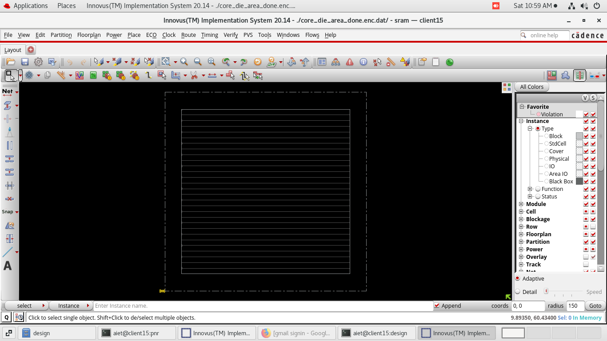
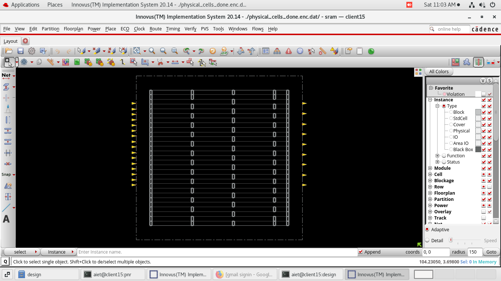
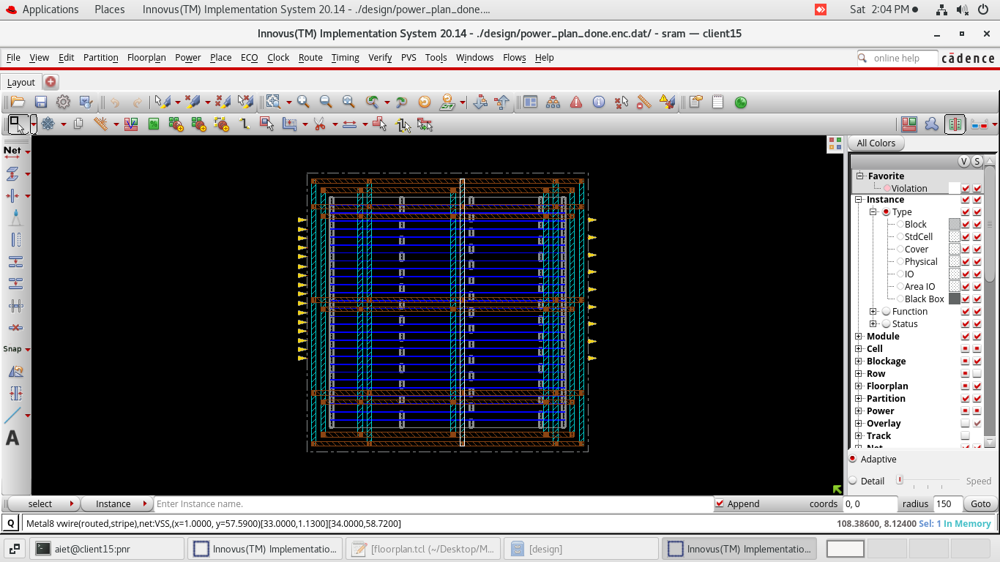
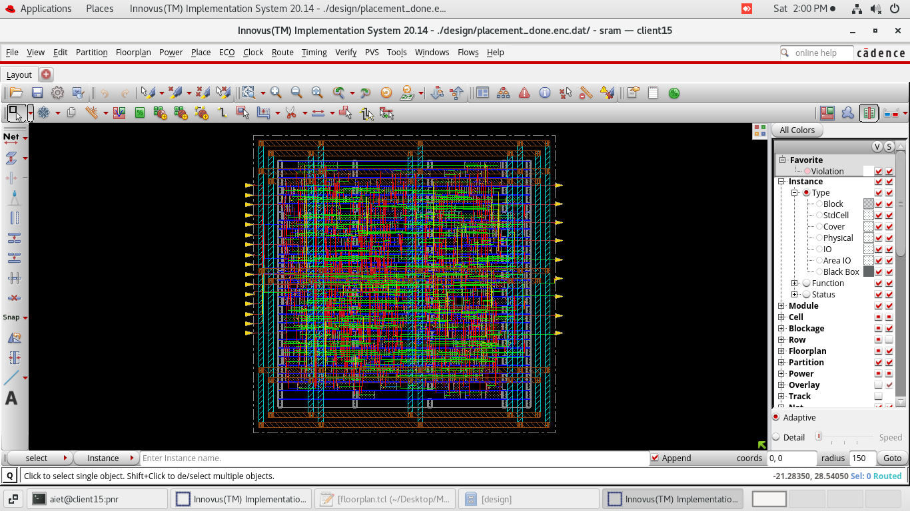
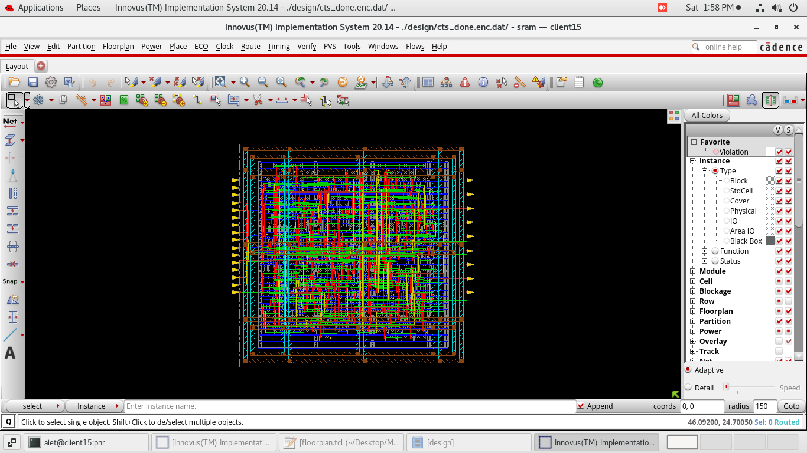
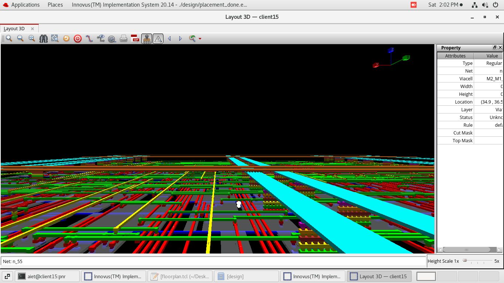

# 45nm SRAM Controller – ASIC Physical Design

End-to-end ASIC Physical Design implementation of an 8-bit × 16-word SRAM Controller using Cadence Genus and Innovus with a 45nm standard-cell technology library.

## Project Overview

- Design: 8-bit × 16-word SRAM Controller
- Technology: 45nm
- Flow: Synthesis -> Floorplanning -> Power Planning -> Placement -> CTS -> Routing -> GDSII
- Target Clock Period: 5.4 ns
- Target Frequency: ~185 MHz
- Synthesis Tool: Cadence Genus
- P&R Tool: Cadence Innovus
- Technology Library: gsclib045

## Physical Design Flow

1. Floorplanning and core utilization setup
2. IO pin placement
3. Physical-only cell insertion
4. Power planning and PG connectivity
5. Standard-cell placement and optimization
6. Clock Tree Synthesis using CCOpt
7. Signal routing
8. DRC and connectivity verification
9. GDSII stream-out

## Repository Structure

scripts/
|-- floorplan.tcl
|-- floorplan_new.tcl
|-- power_plan.tcl
|-- placement.tcl
|-- cts.tcl
|-- route.tcl

inputs/
|-- memory_netlist.v
|-- memory_sdc.sdc

reports/
|-- chek_lef.txt
|-- netlist_check.txt

screenshots/
|-- 01_core_die_area.png
|-- 02_port_placement.png
|-- 03_physical_cells.png
|-- 04_power_plan.png
|-- 05_placement.png
|-- 06_cts.png
|-- 07_3D_layout.png

## Implementation Screenshots

### Core / Die Area

### Port Placement

### Physical Cells

### Power Planning

### Placement

### Clock Tree Synthesis

### Final 3D Layout

## Notes

This repository contains the Tcl implementation scripts, timing constraints, synthesized netlist, verification reports, and physical design screenshots.

Technology PDK files, standard-cell libraries, generated Innovus databases, and other tool-generated files are intentionally excluded.
